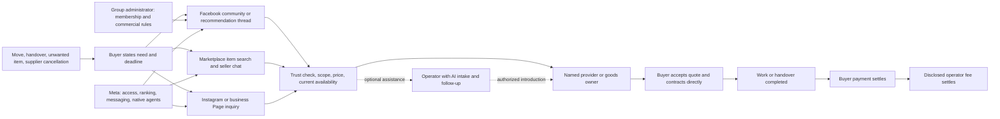

**Decision: fund a small manual transaction test, not a product.** The strongest test is a disclosed, provider-paid introduction and booking-assistance service for time-bounded move-out cleaning. Start near Lowell, Massachusetts, within the user's 50-mile limit. Public evidence establishes real purchases in these markets and several coordination problems. It does **not** establish a proprietary Meta distribution advantage, profitable brokerage, or willingness to pay this operator.

Research date: October 19, 2026. No outreach, account connections, purchases, bookings, or payments were executed. No software was built. Prices below are either explicitly attributed observations or labeled experimental assumptions. Existing procurement research in this workspace is unrelated and unchanged.

**What was actually observable.** This is purposive desk research, not a representative sample or a live lead feed. Searches covered recommendation requests, missed appointments, replacement suppliers, bulky-item transactions, group buying, referrals, and resale assistance before the local test was selected. The user subsequently specified a 50-mile radius around Lowell. Existing audience, group membership, and provider relationships remain unconfirmed.

Facebook's authenticated group conversations were not accessible here. Direct Facebook Help and developer-document requests frequently returned login blocks or HTTP 429. Several Reddit originals were readable only through search-indexed primary-page text; these are labeled in the evidence ledger. Historical Facebook conversations mirrored by WhoDoYou were treated as secondary records, not independently inspected original Facebook threads. No private DMs, invoices, bank statements, or settlement records were inspected. Publicly visible testimony is not verified payment evidence.

Evidence levels used throughout: **request** = a person states a need; **offer** = a supplier advertises terms; **booking** = reported commitment; **completion report** = somebody says work or exchange occurred; **payment report** = somebody says money changed hands; **verified payment** = reconciled transaction records. This research contains no verified payments. A provider's “sold” flag, a review, and a large comment count do not close that gap.

**People are trying to finish real-world transitions.** The recurring economic event in the strongest local evidence is moving, handing over a dwelling, or getting bulky possessions into or out of it. That event creates deadlines, uncertain scope, access problems, and several people whose schedules must agree.

| Original behavior or commercial record | What it supports | What it does not support |
|---|---|---|
| June 10, 2025, a Lowell resident requested a final deep clean for a two-bedroom, one-bath apartment that month, in English and Spanish. A respondent recommended a cleaner they used. [Original request](https://www.reddit.com/r/LowellMA/comments/1l7mett) | Specific scope, place, deadline, and preference for a trusted introduction; possible value from bilingual intake | A completed booking, price, or demand for a paid intermediary |
| August 28–29, 2026, a Lowell house-cleaner request was followed by the requester's statement that they had already booked before a later supplier replied. [Original thread](https://www.reddit.com/r/LowellMA/comments/1w0z9y9/house_cleaners/) | Buyers act on community requests; opportunities can close quickly | Failure of the existing market; this is also a counterexample to brokerage necessity |
| November 4, 2023, a Lowell buyer compared an $800 deep-clean quote with a $600 initial clean and $700/month for two visits. Another commenter reported paying $240 for an initial deep clean. [Original discussion](https://www.reddit.com/r/LowellMA/comments/17nbugw) | Price uncertainty and scope comparison are real problems | Like-for-like prices, current rates, or a measurable arbitrage spread |
| July 23, 2026, a Boston buyer sought a company that would reliably honor an August 31 move-out booking. [Original request](https://www.reddit.com/r/boston/comments/1v4nqgv/reliable_cleaning_company/) | Reliability at a known deadline matters, beyond finding a name | Year-round volume; August 31 is an unusually concentrated moving period |
| April 25, 2026, a Boston buyer without a vehicle wanted a dresser and delayed collection. A commenter offered a free oak dresser if transport could be arranged. [Readable original exchange](https://www.reddit.com/r/boston/comments/1svd3hc/anywhere_to_get_decent_furniture_that_may_let_you/) | Supply and demand coexist while transport prevents completion | That this price-sensitive buyer can support a second coordination fee |
| May 15, 2023, a Lowell resident described the local Facebook free-items community and observed that prospective recipients often wanted delivery. [First-person account](https://www.reddit.com/r/LowellMA/comments/13i8cxc) | A local Meta-related distribution channel and a transport bottleneck | Permission to commercialize that community, current activity, or willingness to pay |
| June 22, 2021, a downtown Lowell resident requested bulky-waste help; later reported the incumbent crew had come and did well. [Original exchange](https://www.reddit.com/r/LowellMA/comments/o5n27v) | A request-to-reported-completion sequence | Price, bank settlement, or incremental value from a broker |
| Furniture Consignment Gallery publishes consignment terms and inventory marked sold, with a Burlington location. [Terms](https://www.furnitureconsignment.com/pages/our-consignment-terms), [store](https://www.furnitureconsignment.com/) | An operating local institution sells the outcome of disposing of furniture and recovering money | Realized sale prices, consignor proceeds, or its profit margin |

These records show recurring *types* of friction, not their incidence. They also show buyers obtaining solutions. The missing variable is the share of requests still unresolved when a permitted operator encounters them. The inspected Office & Home Cleaning website already collects ZIP code, square footage, desired service and referral source and links to its Facebook and Instagram accounts. Structured intake therefore is not a novel capability. No original Instagram buyer conversation was inspected, so Instagram is assessed here as an authorized business contact channel, not a demonstrated source of unmet local demand.

**The demand and distribution system.**

The buyer controls intent and consent; the administrator controls community admission and commercial participation; Meta controls technical access and discovery; the provider controls available capacity and the quote. An independent operator owns none of these by default. Its potential asset is an earned network of responsive businesses plus permission to introduce customers, backed by records of fulfillment.

| Channel | Why demand appears there | Access and acquisition friction | Plausible operator role |
|---|---|---|---|
| Facebook Groups | People ask neighbors to reduce uncertainty about whom to trust | Membership, relevance, admin rules, other recommendations; no verified automated monitoring route in this research | Disclosed replies to permitted requests and voluntary referrals |
| Marketplace | People already want to buy or dispose of particular goods | Ranking, seller trust, condition, inspection, pickup timing | Physical inspection or handover assistance; transport introductions where lawful |
| Instagram | Visual proof and supplier discovery can lead to business inquiries | Existing attention belongs to the business; account access must be delegated | Handle opted-in inquiries for an authorized business; no evidence here of a free new audience |
| Business Pages | Business identity, evidence of previous work, and contact point | A Page alone supplies no traffic or independent reputation | A transparent destination for referrals and a documented booking process |
| Muse | Consumer or business delegates a task | User connection, action scope, approvals, eligibility, and reliability | Reduce clerical work; may also replace the proposed intermediary |

Community permission is an economic input. For example, [Medford Oregon Residents' own rules](https://medfordoregonresidents.com/index.php/rules/) restrict promotion to a designated business post. [Palm Beach Moms' own media kit](https://palmbeachmomsnetwork.com/media-kit/) describes a private group that forbids selling while the organizers monetize separate partnerships. These are evidence of gatekeeping and value capture elsewhere, **not Lowell rules**. No current Lowell-area Facebook group's commercial permissions were verified. A [Lowell Reddit moderator's intervention](https://www.reddit.com/r/LowellMA/comments/1iwk5ud) also illustrates that even local commercial participation may come with conditions. Do not transfer one community's rules to another.

**Jobs-to-be-Done and transaction costs explain the possible margin.** A tenant's job is to hand over a ready apartment by a deadline with minimal coordination. A furniture seller's job is to clear space and realize acceptable proceeds before moving. A buyer's job is to get an appropriate item into the home at an acceptable *delivered* price. The supplier's job is to fill suitable paid capacity without wasting time on unsuitable or duplicate inquiries.

Search is only one cost. Buyers must specify the job, compare nonidentical quotes, establish trust, coordinate access, verify completion, and resolve failures. Providers must travel, manage crews, estimate scope, collect payment, and handle rework. An agent can translate intake, find missing details, compare approved quotes, maintain availability records supplied by businesses, and prepare confirmations. It cannot manufacture a trustworthy crew, physically inspect an unseen sofa, guarantee attendance, or turn a gift-card referral program into cash.

The commercial boundary is important: sell a completed introduction and documented booking assistance while the established provider scopes, prices, contracts, performs, and invoices. Taking responsibility for fulfillment or directing individual workers creates a different operating and legal model. A label such as “referral” does not determine legal classification.

**Three competing opportunities, ranked for the first experiment.** This is an ordinal judgment about testability under limited capital. It is not a revenue forecast or a statistical score.

| Rank and mechanism | Economic evidence | Time to first collected fee: planning assumption | Acquisition and margin | Capital, dependency, and defensibility |
|---|---|---|---|---|
| **1. Provider-paid, completed-job introductions for time-bounded move-out cleaning** | Local scoped requests, reported bookings and spending; local advertised job prices; nearby provider referral incentives | Target 7–21 days after permissions and partner terms exist; unmeasured | Must recruit both providers and permissible demand access. A proposed $60 fee on a $300 job is 20% of the ticket, so provider economics can easily veto it | Pilot capped at $100; no payroll or job pre-financing. High initial channel dependence. Some defense from trusted availability and fulfillment history, little from AI itself |
| **2. Seller-paid resale assistance with attended handover, without buying inventory** | Local consignment institution, published fee schedule, and sold flags; Marketplace transaction testimony | Target 1–4 weeks; unsold items may take indefinitely | Finding an owner willing to delegate access is difficult. Higher fees possible for valuable bundles; low-priced individual items are poor candidates | No inventory capital if owner retains goods, but travel, insurance, and business compliance cost money. Native Meta AI strongly erodes listing-only value; physical handling remains |
| **3. Buyer-paid coordination of bulky-item collection and delivery** | Local buyer/available-item mismatch and outside-market reports of paid delivery; established delivery services already address it | Target days to two weeks once a lawful provider relationship exists; unmeasured | Two locations, timing, stairs, fit, and transport all complicate the job. A separate coordination fee is unproven; standard Lugg referrals produce credits | Low cash only if buyer pays carrier directly. High substitution and potentially material transport-broker regulation. Weak defense unless bundled routes or hard-to-serve coverage are demonstrated |

For opportunity 1, [Paula's Lowell service page](https://paulascleanings.com/move-in-out-cleaning-lowell-ma/) advertises prices **from $269**. [Dyment's page](https://dymentcleaningservice.com/move-out-cleaning/) lists **$300** and optional add-ons, while describing appliance cleaning in the scope: that ambiguity itself requires a written quote. These are supplier asks, not completed invoice prices. [Office & Home Cleaning in Leominster](https://officehomecleaning.com/referral-program/) offers a **$100 Amazon gift card** after a referred purchase. Its published territory does not establish Lowell coverage. Its program shows a willingness to reward acquisition, not willingness to pay this operator $60 cash. [Shine Bright](https://shinebrightmaidservice.com/refer-a-friend/) advertises a $50 prepaid card but serves a different Massachusetts area; it is a mechanism comparator, not a local partner.

**The strongest counterargument to opportunity 1:** the best cleaners may already be full, while buyers can get free recommendations and book directly. The late-supplier Lowell thread shows exactly that. If cheap reliable supply is scarce, an agent cannot remove the scarcity; it adds another mouth to feed. If ordinary recommendations already clear the market, it adds no value. Recurring revenue is not assumed: a one-time introduction normally earns a one-time fee.

For opportunity 2, Furniture Consignment Gallery's initial 60-day split is 50/50, followed by different terms if the item takes longer to sell. This is compensation for a real retail operation, not a margin available to a newcomer without showrooms or buyers. An out-of-area [VaultXL sell-before-you-move offer](https://vaultxl.com/services/sell-before-you-move) advertises 15% after marketplace fees, with possible setup charges and attended pickups. Treat both as competing offers, not proof of profitable unit economics.

**The strongest counterargument to opportunity 2:** people may primarily be buying immediate removal, storage, or a trusted physical representative. Eliminating those assets may eliminate the value. Muse can already advertise the digital part of the work. At an illustrative 20% commission, a $250 sale earns $50; two hours at a $30/hour labor hurdle plus $10 travel leaves **negative $20**. Unsold work makes it worse. A $1,000 sale could leave $130 under the same assumptions, but neither that sale value nor demand for the proposed service is established.

For opportunity 3, [Lugg already offers Marketplace pickup](https://lugg.com/facebook-marketplace-delivery), including multiple stops. Its [official referral terms](https://lugg.com/help/pricing/does-lugg-have-referral-program) offer **$10 in service credit**, not operator cash, after completion, with a $200 accumulated-credit cap. [Seller accounts of delivery fees](https://www.reddit.com/r/FacebookMarketplace/comments/1outhjs/do_people_charge_for_local_delivery/) show that delivery can be paid, but do not establish willingness to pay a person who neither owns a vehicle nor carries anything.

**The strongest counterargument to opportunity 3:** the fee belongs to the scarce truck and labor, while coordination is already bundled into the carrier's price. A hypothetical $25 coordination fee with 45 minutes of labor at $30/hour and $3 of cash cost loses $0.50. A $10 credit produces zero cash revenue. Transport registration and insurance can make a seemingly small brokerage unsuitable for this budget.

**Porter's Five Forces point toward thin brokerage margins.**

| Force | Cleaning introductions | Resale assistance | Delivery coordination |
|---|---|---|---|
| Rivalry | Existing cleaners, community referrals, directories and booking sites | Consignment shops, owner self-sale, estate services | Carriers, Lugg, Taskrabbit, sellers who deliver |
| Buyer power | High: free alternatives and price comparison | High for ordinary goods; deadlines may increase willingness to delegate | High because delivered total must beat alternatives |
| Supplier power | High when reliable crews are fully booked | Owner controls reserve price, availability and access | High: insured vehicles and labor are required |
| Entry barriers | Easy to imitate an introduction; hard to earn trust and repeat fulfillment | Easy to generate listings; harder to attend pickups and bear responsibility | Easy to suggest a carrier; harder to operate or broker legally |
| Substitutes | DIY, direct booking, trusted neighbor, native agents | Donation, free pickup, shops, Muse/Seller | Rental vehicle, friend, retailer delivery, direct carrier booking |

Meta and group administrators also exercise gatekeeper power across these forces. The operator has a potentially useful *service*, but no demonstrated structural distribution moat.

**Other mechanisms were considered and rejected for the first test.** Selling raw lead alerts has no demonstrated local buyer willingness to pay and can create duplicate leads and access-policy problems. A sponsored community or paid vendor directory requires the audience or administrator relationship the operator does not yet have. Paid recommendations must be disclosed; hidden commissions would damage the very trust being monetized.

Demand aggregation can save a supplier travel time if several confirmed jobs share a route. But no inspected local record proves that buyers will synchronize schedules or that suppliers will share enough savings. A [standing-desk group-buy offer](https://ulti.sg/group-buy) in Singapore publishes volume thresholds; it establishes an offered mechanism elsewhere, not a Lowell opportunity. Do not collect pooled deposits before proving a local supplier discount and buyer commitments.

Emergency wedding replacement has concrete demand, but a [June 2026 bride's account](https://www.reddit.com/r/weddingplanning/comments/1u3nxbm/photographer_cancelled_a_week_before_the_wedding/) reports finding a replacement through Facebook within 24 hours. That is a strong free-substitute counterexample, and service failure would be especially costly. Airbnb cleaning is also crowded: [Turno's pricing](https://turno.com/pricing./) provides no-subscription plans for hosts using its marketplace cleaners exclusively; payment/service charges are separate. A generic cleaner-matching app would enter an existing market without an established distribution advantage.

**Meta's documented capabilities are already a competitive threat.** The following distinguishes documentation from successful execution. No authenticated Muse or Meta API workflow was tested in this session.

| Surface | Verified documentary evidence | Practical limit |
|---|---|---|
| Muse shopping | Meta explicitly advertises Marketplace watching, matching alerts, offers/negotiation, and listing/selling items. [Official feature page](https://ai.meta.com/muse/shopping/) | Product claim, not a measured success rate; not evidence of a public third-party Marketplace API or permission for unrelated scraping |
| Muse for Small Business | Meta documents connections to Instagram professional analytics, Facebook Pages, ad accounts, and business tools, with approval controls. [September 29 announcement, updated October 8](https://about.fb.com/news/2026/09/introducing-muse-small-business/) | Business account authority and connector availability matter; an announcement about finding customers does not prove acquisition or payments |
| Muse connectors | Reviewed connectors can support search, availability, booking and payment. Sensitive writes require approval each time; account connection is not blanket consent. Secondary data sale is prohibited. [Official connector guidelines](https://platform.muse.ai/docs) | Read permissions, non-sensitive writes, and sensitive writes differ. Authentication/identity/payment verification may still require the user. Listing links alone is not a complete transaction integration |
| Native Marketplace AI | Listing drafts, local-listing-based price suggestions, availability auto-replies and seller-profile summaries are documented. [Official release](https://about.fb.com/news/2026/03/facebook-marketplace-new-meta-ai-tools-make-selling-faster-and-easier/amp/) | Asking prices are not realized prices; profile summaries do not establish service quality or settlement |
| Seller app | Meta describes inventory, inbox and listing tools for Marketplace sellers. [Official announcement](https://about.fb.com/news/2026/07/introducing-seller-app-facebook-marketplace/?trk=article-ssr-frontend-pulse_little-text-block) | Another substitute for a listing-management service; rollout/account availability must be checked |
| Facebook Pages API | Meta's published API collection documents obtaining tokens for Pages the user manages. [Meta Postman collection](https://www.postman.com/meta/facebook/documentation/r56bjfd/facebook-api?entity=request-23987686-a9ea20fe-d410-4804-8bbe-5cc5985e9443) | Page authority is not authority over personal profiles, groups or arbitrary Marketplace conversations. Endpoint permissions and production access need verification before implementation |
| Instagram API | Meta's indexed collection describes professional-account messaging and customer-initiated conversations; it lists messaging, comment and publishing scopes. [Meta Postman collection](https://www.postman.com/meta/instagram/documentation/6yqw8pt/instagram-api?entity=request-23987686-3a63181c-e5c6-4890-96dd-e4d425bef5e0) | Not arbitrary consumer-account access or cold-DM permission. Direct fetch rendered only the documentation shell. Exact current response-window exceptions were not independently verified; do not implement them from memory |
| Facebook Groups | The legacy Groups API's April 2024 removal is documented in secondary reproductions, but the [official v19 changelog](https://developers.facebook.com/docs/graph-api/changelog/version19.0/) returned 429 here | Treat programmatic group access as **unverified and unavailable for this experiment**. Admin permission alone does not supply platform authorization |

Meta explicitly distinguishes authorized from unauthorized collection and says unpermitted automated Facebook data collection violates its terms. [Meta explanation](https://about.fb.com/news/2021/04/how-we-combat-scraping/?itid=lk_inline_enhanced-template). Current [Automated Data Collection Terms](https://www.facebook.com/legal/automated_data_collection_terms) could not be directly read here; the [2026 Muse connector terms](https://platform.muse.ai/terms) independently prohibit exceeding declared scope and extracting data through scraping connectors. A browser that can click is not an authorization mechanism. A native Muse integration can have rights that a third-party bot does not.

The [official service-listing policy page](https://www.facebook.com/policies_center/commerce/services) also returned a login block. Secondary accounts describe a service-listing prohibition. Therefore the pilot uses **no Marketplace service listings** and does not disguise a cleaning advertisement as a physical item. Verify any future category-specific exception in the actual account and current official terms.

The agent may prepare scoped intake, quote comparisons, draft messages and reconciliation notes from voluntarily supplied information. A human verifies supplier identity, coverage, quotes, availability, customer consent and payment evidence. Any send/publish/purchase requires the authorization applicable to the actual interface. Never upload access codes or unrelated private group conversations merely to make an AI workflow convenient.

Listing text, generic recommendation summaries, price alerts, and routine messaging are already commoditizing. Claims on these alone should be abandoned. Verified off-platform capacity, physical work, reliable escalation and a voluntarily retained customer relationship could survive longer. Even those may be absorbed if Meta gives buyers reliable direct booking and remedies; the operator must continually measure why the customer still chooses it.

**Massachusetts constraints alter the ranking.** Disclose financial ties at the recommendation, consistent with [FTC endorsement guidance](https://www.ftc.gov/business-guidance/resources/ftcs-endorsement-guides-what-people-are-asking). Get consent before forwarding contact details. Do not imply that a supplier has been personally used, independently insured, or background checked without evidence.

Massachusetts [employment/placement agency guidance](https://www.mass.gov/info-details/information-about-registering-an-employment-placement-or-staffing-agency) specifically addresses domestic-worker placement. The proposed pilot introduces customers to an established cleaning business that contracts and supervises its own work; it does not recruit or place individual domestic workers. That is a proposed scope boundary, not a legal exemption determination. Confirm the classification before trading; if clearance or registration cannot fit the budget and schedule, stop this version. Do not quietly switch to directing independent cleaners.

Do not sell cleaning by telling tenants it is legally required or guarantees return of their deposit. Massachusetts' [2025 landlord-tenant guide](https://www.mass.gov/doc/2025-guide-to-landlord-tenant-rights-11182025/download) lists mandatory end-of-lease professional cleaning among impermissible lease terms. The customer is voluntarily buying convenience and a defined result.

For delivery, [Massachusetts DPU guidance](https://www.mass.gov/guides/moving-within-massachusetts) requires authority for household movers; [FMCSA broker registration](https://www.fmcsa.dot.gov/registration/broker-registration) includes a $75,000 bond or trust requirement for covered brokers. A surety bond is not necessarily $75,000 cash outlay, but neither is it a free administrative detail. A 50-mile Lowell radius crosses New Hampshire: keep the first pilot within Massachusetts, and do not assume intrastate and interstate rules are interchangeable. For consignment, [Massachusetts DOR guidance](https://www.mass.gov/directive/directive-88-12-consignment-sales-sales-at-auction) demonstrates that consigned goods can be taxable retail sales. Keeping inventory at the owner's house does not by itself establish a tax exemption. Municipal registration/licensing and insurance remain operational checks for any later resale pilot.

**The falsifiable thesis.** Within permitted local communities, some buyers with an imminent apartment handover will voluntarily accept help documenting scope and finding an available established cleaning business. At least two providers will agree to pay cash for *incremental completed jobs*, and enough such jobs can be closed that total ongoing acquisition and coordination time earns at least $30/hour after cash costs. AI must reduce that time without increasing mistakes. Meta-specific advantage requires the successful customers to originate through permitted Meta distribution, not merely through the operator's personal network or unrelated sites.

Three distinct claims must pass: demand exists; the operator adds billable value; Meta plus AI improves the economics. Existing evidence supports only the first with reasonable confidence. The [prepared transaction protocol](meta-transaction-experiment.md) tests the second and begins testing the third. Its cash and time thresholds are decision rules, not estimates derived from this small convenience sample.

**Investment stance.** Authorize at most the manual research/transaction budget in the protocol. Continue only on reconciled customer and operator payments and measured contribution. If it works equally well outside Meta, call it a local referral business. If it works only with the operator physically doing the job, call it a local service business. If native Muse or free community recommendations remove the need for the operator, abandon the distribution-arbitrage claim. None of those outcomes justifies building a lead-scraping product first.
